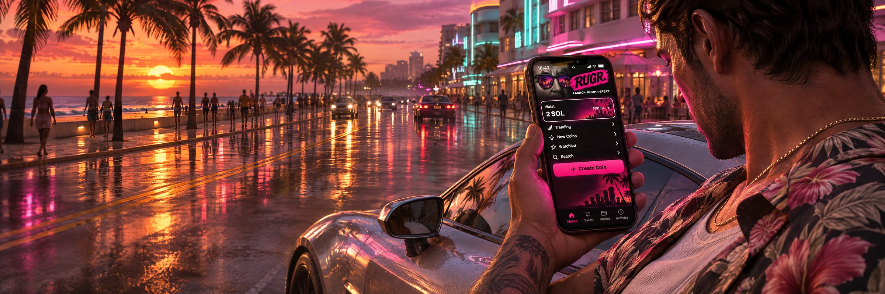
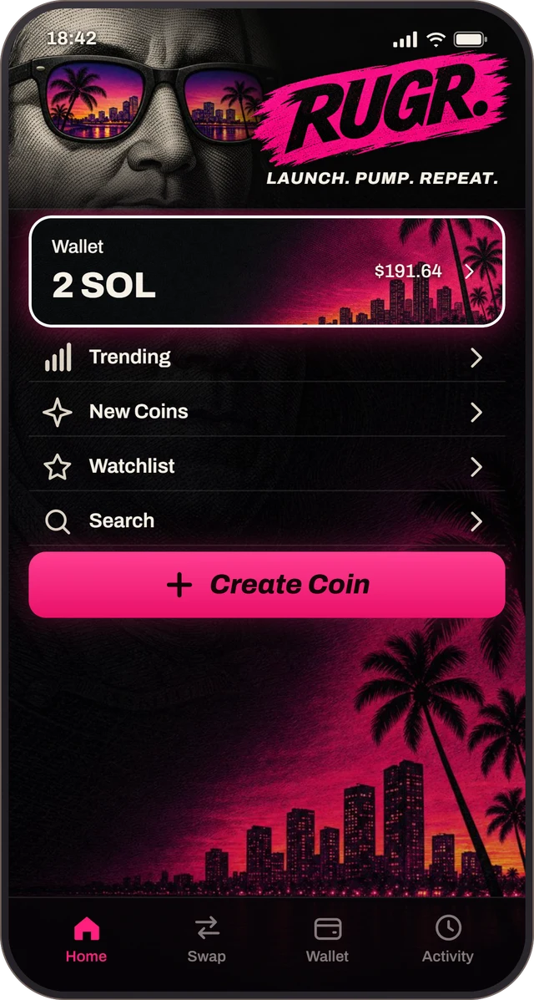
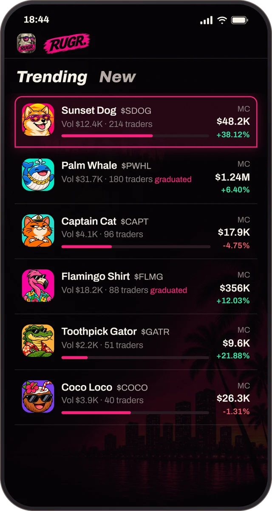
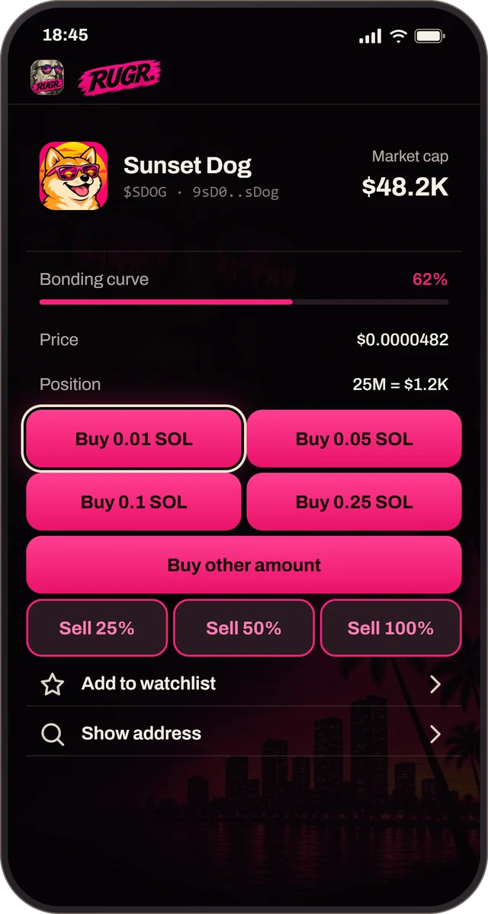
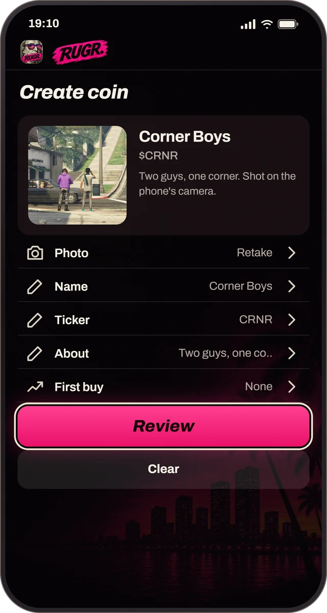
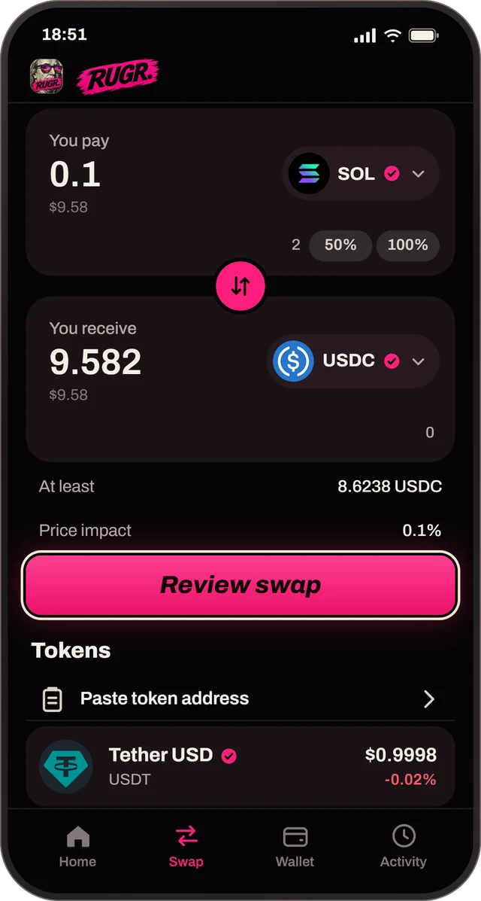
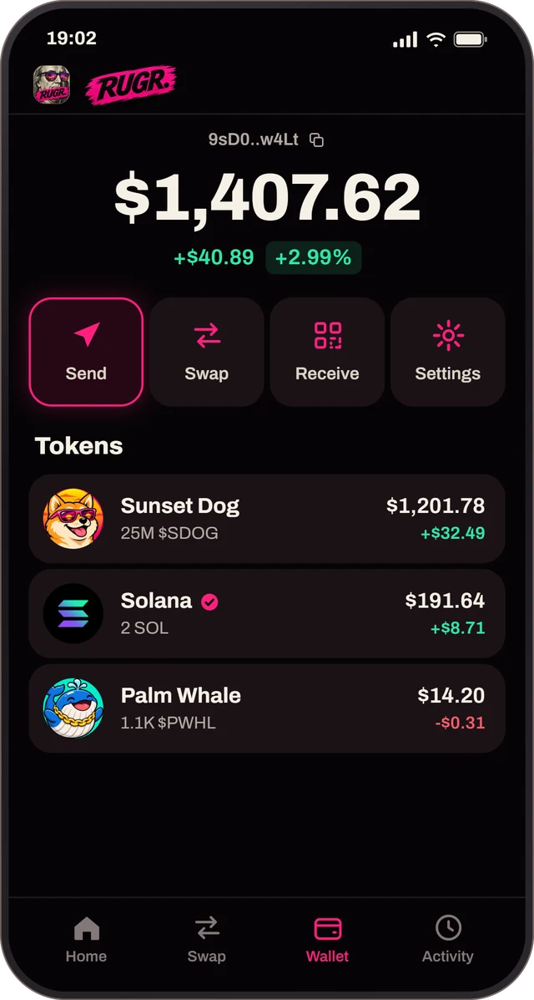
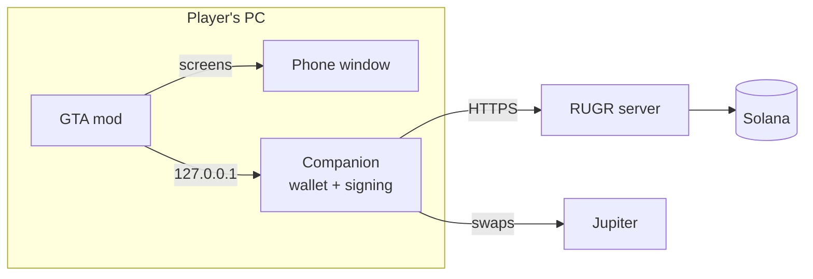

<p align="center">
  
</p>

<h1 align="center">GTAMOD</h1>

<p align="center">
  <strong>Blockchain mods for GTA V and GTA VI.</strong><br>
  RUGR puts a real Solana wallet and trading app on the in-game phone. Launch a coin, trade it and swap any token without leaving the game.
</p>

<p align="center">
  <strong>$GTAMOD CA:</strong> <code>GSfFkc7Bkz8RRRTFgCwasMhn48PWhKm1ehDcxaHdi6ea</code>
</p>

<p align="center">
  <a href="https://github.com/GTADOTMOD/GTAMODS/actions/workflows/ci.yml"></a>
  <a href="LICENSE"></a>
  
  
  
  
</p>

<p align="center">
  <a href="https://gtamod.onrender.com">Website</a> ·
  <a href="https://gtamod.onrender.com/download.html">Download</a> ·
  <a href="https://x.com/GTADOTMOD">X</a> ·
  <a href="docs/USER_GUIDE.md">User guide</a> ·
  <a href="https://github.com/GTADOTMOD/GTAMODS/issues">Report a bug</a>
</p>

---

## Overview

**RUGR** is a single-player mod that adds a working crypto app to the character's phone in GTA V, and it's built to
work with GTA VI too, with just a few adjustments. It holds a real Solana wallet on your PC, trades pump.fun coins and
any other Solana token, and launches new coins, with a logo you shoot with the game's own phone camera.

- **Launch coins in-game.** Name, ticker, description and a photo from the phone camera; the coin is created on
  pump.fun, followed by your first buy.
- **Trade.** Buy and sell on pump.fun bonding curves and PumpSwap. The confirm screen shows exactly what the chain
  will enforce: the most SOL a buy can spend and the least a sell can return.
- **Swap any token.** Paste a token address and swap through Jupiter, with price impact and minimum received.
- **A full wallet.** Create or import a wallet, send and receive (with a QR code), and see your tokens and their value
  in dollars.
- **RUGR Trending and New.** Lists made only of coins launched through RUGR, verified on-chain.
- **Practice first.** Every new wallet starts in Practice: transactions are simulated against mainnet and never sent,
  until you switch to real money with your password.
- **One-click install.** RUGR Setup finds the game and installs everything RUGR needs.

## Screenshots

<table>
  <tr>
    <td align="center"><br><sub>Home</sub></td>
    <td align="center"><br><sub>Trending</sub></td>
    <td align="center"><br><sub>Coin page</sub></td>
  </tr>
  <tr>
    <td align="center"><br><sub>Create coin</sub></td>
    <td align="center"><br><sub>Swap</sub></td>
    <td align="center"><br><sub>Wallet</sub></td>
  </tr>
</table>

<p align="center"><sub>The app's real screens, drawn with sample data.</sub></p>

## How it works



The wallet never enters the game process, where every other Script Hook mod also runs. The mod only reads the
player's input and reports what was picked. The **companion**, a small program with no window, holds the encrypted
wallet, prices every trade from on-chain state with pump.fun's official SDK, and signs. The **RUGR server** relays
Solana RPC calls, hosts new coins' pictures and metadata, and lists the coins launched through RUGR. It never sees a
key or signs anything.

More detail: [the app's screens](docs/APP.md) · [security model](docs/SECURITY_MODEL.md) · [project status](docs/STATUS.md)

## Repository layout

| Path | What it is |
|---|---|
| [`mod/`](mod) | The game script (C#, on ScriptHookVDotNet 3 in GTA V). Starts the other parts, reads the phone's keys and the camera. |
| [`mod/phone/`](mod/phone) | PumpPhone, the always-on-top phone window that shows the app over the game (WebView2). |
| [`companion/`](companion) | The wallet, trading and every screen (Node.js, TypeScript). Includes a browser simulator of the phone. |
| [`server/`](server) | RUGR's server: Solana RPC relay, coin metadata hosting and RUGR's Trending and New. |
| [`installer/`](installer) | RUGR Setup, the one-click Windows installer (.NET Framework 4.8). |
| [`landing/`](landing) | The GTAMOD website: a static site with no build step. |
| [`brand/`](brand) | Source logos for GTAMOD and RUGR. |
| [`docs/`](docs) | User guide, building, security model and status. |

## Getting started

### Players

1. Download **RUGR Setup** from the [download page](https://gtamod.onrender.com/download.html).
2. Run it and press **Install**. It finds GTA V on Steam, Epic Games or the Rockstar Games Launcher, installs Script
   Hook V, ScriptHookVDotNet and iFruit Jailbreak, and switches the game to borderless.
3. Start GTA V in story mode, open the phone and choose **RUGR**. Create a wallet, then try everything in Practice.

The installer isn't code-signed yet, so Windows SmartScreen may warn about it; the download page lists its SHA-256.
See the [user guide](docs/USER_GUIDE.md) for controls, funding, going live and settings.

### Developers

You need Node.js 20 or newer and, for the C# parts, the .NET SDK with the .NET Framework 4.8 targeting pack.

```bash
# Wallet, trading and screens
cd companion
npm ci
npm test
npm run sim -- --fake     # every screen in the browser at http://127.0.0.1:47616, no game needed

# Server
cd server
npm ci
npm test
```

The mod compiles against iFruit Jailbreak, which isn't in this repository: see [`mod/lib/README.md`](mod/lib/README.md).
[`docs/BUILDING.md`](docs/BUILDING.md) covers building the mod, the phone window and the companion, installing them by
hand, and a full release with RUGR Setup.

## Security

- The wallet is encrypted on your PC with scrypt and AES-256-GCM, and the companion starts locked.
- Keys never leave the PC. The RUGR server only relays RPC calls and coin metadata.
- Real money, exporting the key, raising limits and changing the RPC all ask for your password again.
- The companion's local API listens on 127.0.0.1 only and requires a fresh random token on every run.

Read the full [security model](docs/SECURITY_MODEL.md). To report a vulnerability, follow [SECURITY.md](SECURITY.md)
and please don't open a public issue.

## Contributing

Contributions are welcome. Read [CONTRIBUTING.md](CONTRIBUTING.md) before opening a pull request.

## Disclaimer

GTAMOD and RUGR are independent projects. They are not affiliated with, endorsed by or sponsored by Rockstar Games,
Take-Two Interactive or pump.fun. Grand Theft Auto and GTA are trademarks of Take-Two Interactive Software.

Use mods in **story mode only**, never in GTA Online, and never on roleplay servers. Once you switch from Practice to
real money, RUGR sends real transactions on Solana mainnet. Memecoins are extremely risky, created coins are
permanent, and nothing in this project is financial advice. Keep only what you can afford to lose in the wallet, and
back up its private key.

The banner and the website's artwork are AI-generated illustrations, not game footage.

## License

The code is released under the [MIT License](LICENSE). The GTAMOD and RUGR names, logos and artwork, and third-party
content, are not covered by it: see [THIRD_PARTY_NOTICES.md](THIRD_PARTY_NOTICES.md).
